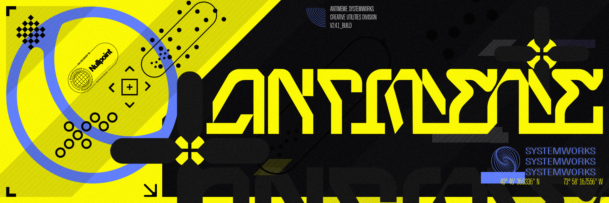

# TOKS ON WINDOWS // TOKENIZER BENCHMARK

ANTIMEME SYSTEMWORKS // CREATIVE UTILITIES DIVISION
AM-RS-2026 // V1.0_BUILD // P.01

17–22x on 512-byte inputs; 41–56x on long and batched inputs, where 58–78% of bytes repeat within the pass.

Native Windows CPU tokenization: toks 0.3.2 AVX2 versus Hugging Face tokenizers 0.23.2. The 6,240 distinct tokenizer/text pairs matched IDs. A reported Ryzen 7 9800X3D, CPython 3.12.14, six balanced rounds and a separate process for each trial. The GPU was unused.

[Interactive results](https://huggingface.co/spaces/b4ph/toks-windows-benchmark) · [Full report](docs/BENCHMARK_REPORT.md) · [Context](docs/EXPERIMENT_CONTEXT.md) · [Reproduce](docs/REPRODUCE.md) · [Public evidence ZIP](https://huggingface.co/spaces/b4ph/toks-windows-benchmark/resolve/main/downloads/TOKS_VS_HF_WINDOWS_V2_PUBLIC_2026-10-18.zip)

## 01 // SINGLE-WORKER RESULTS

Median [minimum–maximum], million input tokens per second. Comparator: the faster measured HF API; it was `hf_fast` in every cell. All input windows may reuse text within a pass.

| CELL | TOKENIZER | INPUT | TOKS M TOK/S [MIN–MAX] | HF M TOK/S [MIN–MAX] | RATIO | REPEATED BYTES |
|---|---|---|---:|---:|---:|---:|
| C01 | zai-org/GLM-5.3-Flash | 512 B | 24.75 [24.47–25.06] | 1.43 [1.39–1.46] | 17.35 | ≈14% |
| C02 | zai-org/GLM-5.3-Flash | 64 KiB | 53.53 [52.69–53.70] | 1.31 [1.27–1.35] | 40.93 | ≈58% |
| C03 | zai-org/GLM-5.3-Flash | 32 × 4 KiB | 73.05 [72.07–74.98] | 1.58 [1.55–1.59] | 46.23 | ≈78% |
| C04 | Qwen/Qwen3.8-27B | 512 B | 25.24 [25.23–25.79] | 1.17 [1.12–1.21] | 21.56 | ≈14% |
| C05 | Qwen/Qwen3.8-27B | 64 KiB | 53.53 [52.42–53.89] | 1.18 [1.17–1.20] | 45.22 | ≈58% |
| C06 | Qwen/Qwen3.8-27B | 32 × 4 KiB | 73.71 [72.43–74.75] | 1.37 [1.37–1.39] | 53.77 | ≈78% |
| C07 | deepseek-ai/DeepSeek-V4.1-Flash-1017 | 512 B | 25.98 [25.13–27.20] | 1.18 [1.15–1.21] | 22.04 | ≈14% |
| C08 | deepseek-ai/DeepSeek-V4.1-Flash-1017 | 64 KiB | 56.10 [52.54–57.03] | 1.16 [1.12–1.17] | 48.36 | ≈58% |
| C09 | deepseek-ai/DeepSeek-V4.1-Flash-1017 | 32 × 4 KiB | 73.70 [71.70–75.35] | 1.31 [1.31–1.34] | 56.06 | ≈78% |

Full precision: [results.tsv](results.tsv). All 72 API/state rows, including warm repetition and eight-worker Python calls: [all-results.csv](all-results.csv).

## 02 // CONDITIONS THAT TRAVEL WITH THE NUMBERS

- Overlapping windows repeat approximately 14% of short, 58% of long and 78% of batch bytes within a pass. Long/batch speedups include that reuse.
- Every toks first pass is too short for reliable in-phase CPU accounting. Each passed a pre-timer idle gate. Startup CPU samples were 2.25–6.45%; accepted per-trial samples were 0.39–9.96%.
- The historical Windows hardware and execution are self-reported. Archive hashes and receipt consistency cannot independently attest them.
- The Windows wheel was built on the fork. It is not an official upstream Windows release. The unrelated PyPI package named `toks==0.3.2` must not be substituted.
- Warm repetition and eight-worker Python call patterns are supplementary. These numbers are CPU input-token rates, not GPU generation speed or TTFT.

## 03 // REVIEW AND EVIDENCE

The independent review recomputed all 576 summary values from 216 raw samples with no mismatches. The extended audit passes 741 checks across 237 distinct timing/parity/rejection identities. A reviewer-built Linux copy matched the Windows token-ID hashes in all nine unique input cells, with ratios of 13.4–44.2x on different hardware. The reviewer did not independently rebuild the Windows binary.

Downloadable evidence includes the wheel, source Git bundle, pinned assets, raw receipts, parity records and auditor. The public derivative removes private desktop metadata with an explicit redaction ledger. Measurements and four hashed source files are unchanged; no timing rerun was performed for publication.

Public archive SHA-256: `716833fe83e11ed15d831c3f4d11bfed971be50c1553bae479cb55687fd956f1`.

## 04 // USE THIS REPOSITORY

Start with [EXPERIMENT_CONTEXT.md](docs/EXPERIMENT_CONTEXT.md). [EDITORIAL_BRIEF.md](docs/EDITORIAL_BRIEF.md) contains reusable copy and facts an editor must preserve. [REPRODUCE.md](docs/REPRODUCE.md) gives exact download/audit commands. `harness/` contains the frozen measurement code for inspection.

Community experiment published by ANTIMEME SYSTEMWORKS. [toks](https://github.com/actual-computer/toks) is Actual Computer's project. The publication does not imply endorsement by Actual Computer or Hugging Face. See [NOTICE.md](NOTICE.md) for source and asset attribution.

AM-RS-2026 // V1.0_BUILD // P.01
